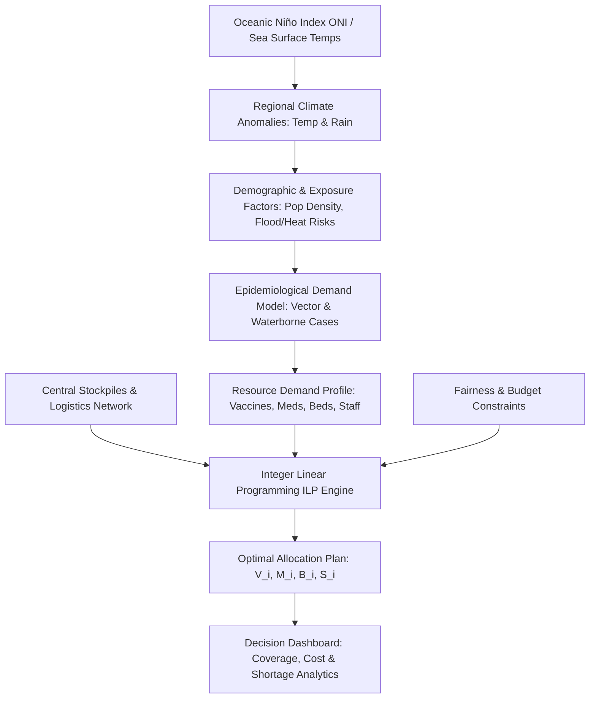
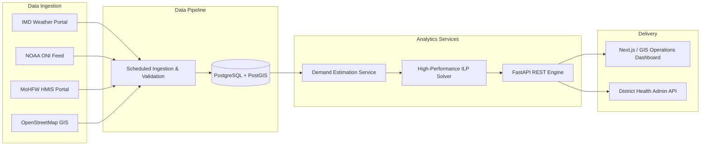

# System Architecture: ElNino Health Resource Optimizer (EN-HRO)

## 1. High-Level Concept

The **ElNino Health Resource Optimizer (EN-HRO)** is a climate-aware decision-support prototype. It connects oceanic climate anomalies to regional public health demand and uses **Integer Linear Programming (ILP)** to optimize the allocation of scarce medical resources (vaccines, medicines, hospital beds, staff) across high-risk regions.

---

## 2. Pipeline Flowchart

---

## 3. Component Architecture

### A. Data Layer (`data/`)
- **Raw Data**:
  - `enso.csv`: Historical and projected Oceanic Niño Index (ONI) series.
  - `climate.csv`: District-level temperature, rainfall, anomalies, and extreme weather risk scores.
  - `disease_demand.csv`: Disease burden calculations for vector-borne and waterborne infections.
  - `healthcare_resources.csv`: Baseline district capacities, inventory, and distance from central logistics hub.
  - `districts.geojson`: Geographic boundaries for map visualization.
- **Processed Data**:
  - `healthcare_optimization_dataset.csv`: Unified analytical dataset.

### B. Machine Learning Demand Estimation (`src/demand_prediction.py`)
- **Model**: Random Forest Regressor trained on parameterized climate-epidemiological simulations.
- **Input Features**: `enso_index`, `rainfall`, `rainfall_anomaly`, `temperature`, `temperature_anomaly`, `population`, `population_density`, `flood_risk`, `heatwave_risk`.
- **Target**: `estimated_disease_cases`.
- **Outputs**: Baseline disease burden feeding into resource demand equations.

### C. Optimization Core (`optimization/`)
- **Formulation**: Multi-objective Integer Linear Program (MILP).
- **Decision Variables**: $V_i, M_i, B_i, S_i \in \mathbb{Z}_{\ge 0}$.
- **Solvers**: HiGHS (via `highspy`) and COIN-OR CBC (via `pulp`).
- **Constraints**: Supply limits, demand ceilings, minimum equity fairness thresholds, and transportation budget caps.

### D. Scenario Simulation Engine (`src/scenario.py`)
- Evaluates what-if counterfactual scenarios:
  - Climate shocks: Escalated El Niño index, extreme heat anomalies, erratic rainfall shifts.
  - Stockpile shocks: Supply chain bottlenecks, vaccine production cuts, budget constraints.
- Real-time recalculation of disease burden and allocation re-optimization.

### E. User Interface Layer (`app/app.py`)
- Built on Streamlit, Plotly, and Folium.
- 10 structured views supporting executive briefings, spatial risk analysis, sensitivity testing, and mathematical transparency.

---

## 4. Production Roadmap Architecture

For real-world state or national deployment, the architecture would transition to automated data pipelines:

